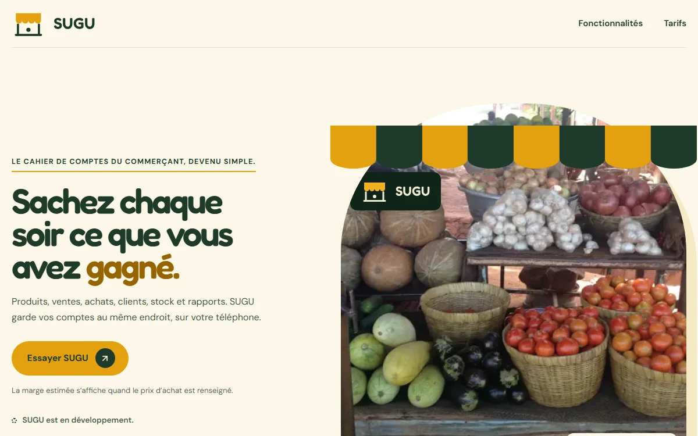
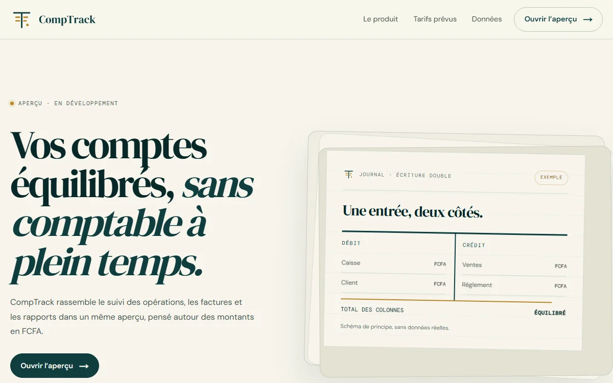
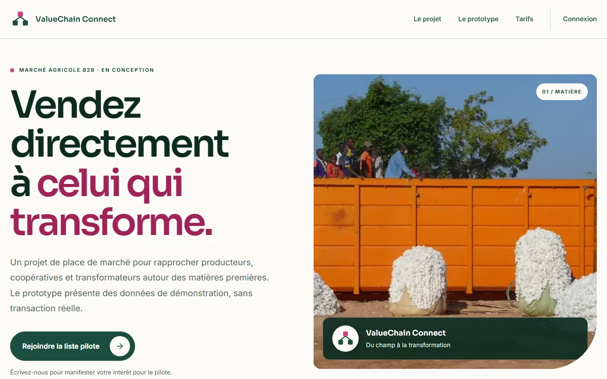
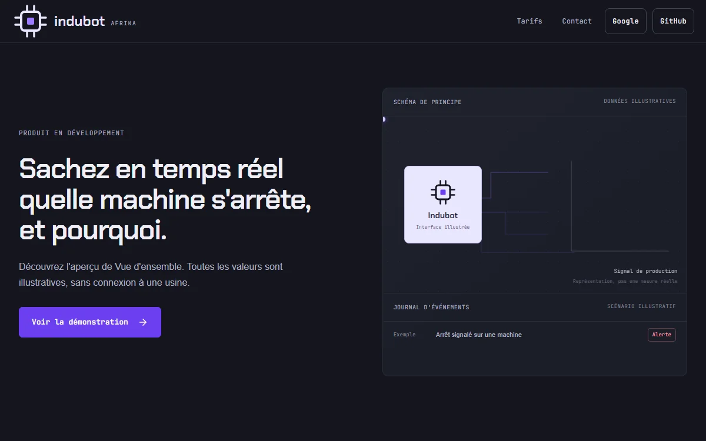
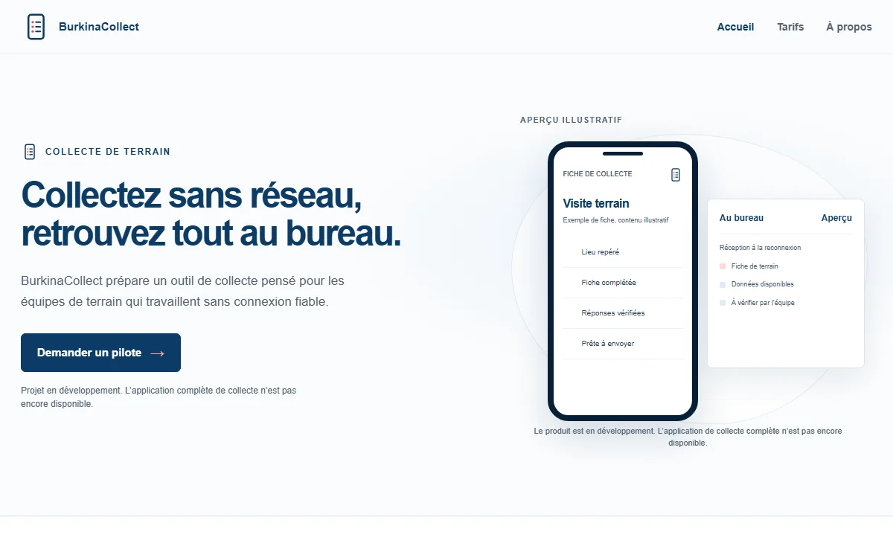
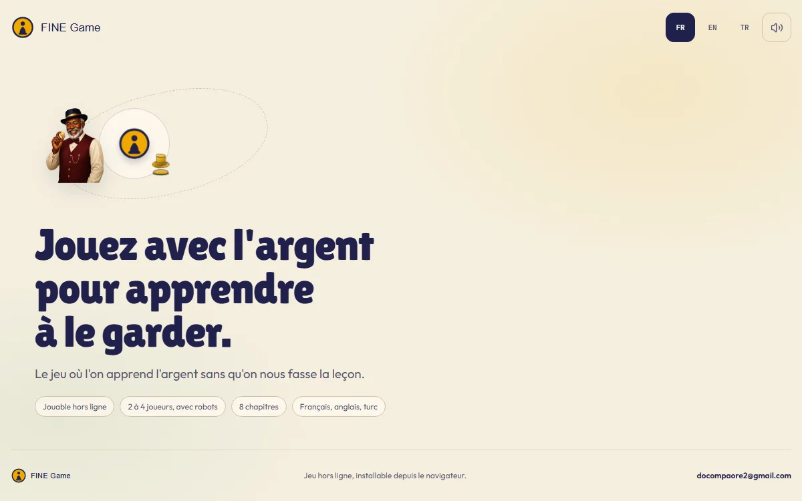
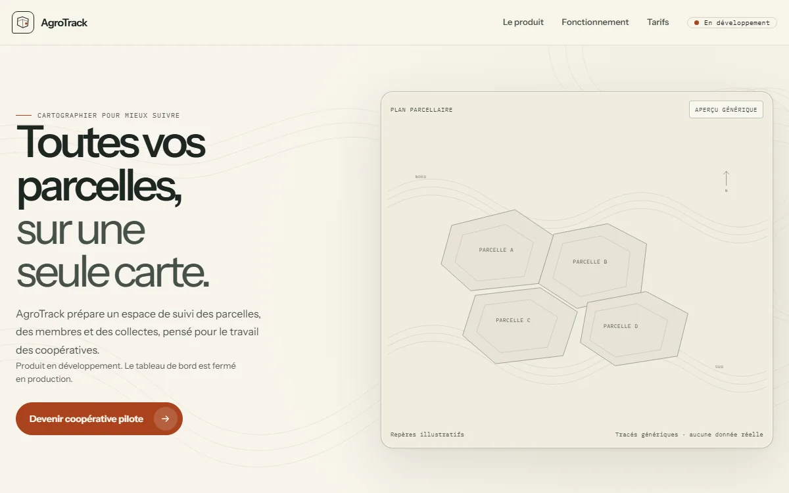

 

  

 

[Français](#fr) &nbsp;·&nbsp; [English](#en) &nbsp;·&nbsp; [Türkçe](#tr)

 

[**Portfolio Ingénieur**](https://portfolio-v2-eight-eta.vercel.app) &nbsp;·&nbsp; [Portfolio Freelance](https://portfolio-freelance-tau-ten.vercel.app) &nbsp;·&nbsp; [Portfolio Académique](https://portfolio-academique-woad.vercel.app) &nbsp;·&nbsp; [Site personnel](https://steevedonaldcompaore.me) &nbsp;·&nbsp; [LinkedIn](https://www.linkedin.com/in/steeve-donald-compaor%C3%A9-65ba13296/)

<b>À propos</b>

 

Étudiant en génie informatique à l'Université Gaziosmanpaşa de Tokat (Türkiye). Je construis des applications web complètes, de l'interface au déploiement, et j'y intègre l'IA.

Je cherche un **stage d'été 2027** en intelligence artificielle, ingénierie ou gestion de projet, à Istanbul, à Tokat ou à distance.

Je travaille avec des agents d'IA de façon structurée (délégation, relecture, tests). Services freelance : sites, applications et contenu automatisé, sur le [portfolio Freelance](https://portfolio-freelance-tau-ten.vercel.app).

**Langues :** français · anglais · turc · mooré · bambara

<b>About</b>

 

Computer science engineering student at Gaziosmanpaşa University in Tokat (Türkiye). I build complete web applications, from the interface to deployment, and integrate AI into them.

I am looking for a **summer 2027 internship** in artificial intelligence, engineering or project management, in Istanbul, in Tokat or remotely.

I work with AI agents in a structured way (delegation, review, testing). Freelance services: websites, applications and automated content, on the [Freelance portfolio](https://portfolio-freelance-tau-ten.vercel.app).

**Languages:** French · English · Turkish · Mooré · Bambara

<b>Hakkımda</b>

 

Tokat Gaziosmanpaşa Üniversitesi'nde bilgisayar mühendisliği öğrencisiyim. Arayüzden yayına kadar eksiksiz web uygulamaları geliştiriyor ve yapay zekâyı bunlara entegre ediyorum.

Yapay zekâ, mühendislik veya proje yönetimi alanında; İstanbul'da, Tokat'ta veya uzaktan **2027 yaz stajı** arıyorum.

Yapay zekâ ajanlarıyla yapılandırılmış biçimde çalışıyorum (görev devri, gözden geçirme, test). Freelance hizmetler: web siteleri, uygulamalar ve otomatik içerik; [Freelance portfolyo](https://portfolio-freelance-tau-ten.vercel.app) sayfasında.

**Diller:** Fransızca · İngilizce · Türkçe · Mooré · Bambara

## Projets &nbsp;·&nbsp; Projects &nbsp;·&nbsp; Projeler

<table>
<tr>
<td width="50%" valign="top"> <b><a href="https://duka-kappa.vercel.app">SUGU</a></b> &nbsp;Prototype Le cahier de comptes du commerçant : ventes, achats, stock et crédit client sur téléphone, en français, anglais, jula et mooré. <i>Product in development. Sales, stock and customer credit for small traders.</i> Next.js · TypeScript · Tailwind CSS · Better Auth</td>
<td width="50%" valign="top"> <b><a href="https://comptrack-chi.vercel.app">CompTrack</a></b> &nbsp;Aperçu Comptabilité en partie double pour PME, en FCFA : opérations, factures et rapports. <i>Double-entry accounting for small businesses, in FCFA.</i> Next.js · TypeScript · Supabase · Framer Motion</td>
</tr>
<tr>
<td width="50%" valign="top"> <b><a href="https://valuechain-connect.vercel.app">ValueChain Connect</a></b> &nbsp;Prototype Place de marché B2B entre producteurs, coopératives et transformateurs. Le prototype utilise des données de démonstration. <i>B2B marketplace linking producers and processors; demo data.</i> Next.js · TypeScript · Supabase · Framer Motion</td>
<td width="50%" valign="top"> <b><a href="https://indubot-afrika.vercel.app">Indubot</a></b> &nbsp;En développement Vue d'ensemble de production en temps réel : quelle machine s'arrête, et pourquoi. Démonstration à données illustratives. <i>Real-time production overview; illustrative demo data.</i> Next.js · TypeScript · Tailwind CSS · Better Auth</td>
</tr>
<tr>
<td width="50%" valign="top"> <b><a href="https://burkinacollect-bf.vercel.app">BurkinaCollect</a></b> &nbsp;En développement Collecte de données de terrain hors ligne pour les équipes de terrain. Vitrine et synchronisation ; l'application de collecte complète n'est pas encore disponible. <i>Offline field data collection; landing page and sync, full app not yet released.</i> Next.js · TypeScript · Tailwind CSS</td>
<td width="50%" valign="top"> <b><a href="https://fine-game-three.vercel.app">FINE Game</a></b> &nbsp;En ligne Jeu de plateau d'éducation financière, jouable hors ligne sur téléphone et ordinateur, de 2 à 4 joueurs avec des robots, en français, anglais et turc. <i>Financial-literacy board game, playable offline.</i> Next.js · TypeScript · Framer Motion</td>
</tr>
<tr>
<td width="50%" valign="top"> <b><a href="https://agrotrack-bf.vercel.app">AgroTrack</a></b> &nbsp;En développement Suivi des parcelles, des membres et des collectes pour les coopératives agricoles. Le tableau de bord n'est pas ouvert en production. <i>Plot and member tracking for agricultural cooperatives; dashboard not open in production.</i> Next.js · TypeScript · Supabase · Tailwind CSS</td>
<td width="50%"></td>
</tr>
</table>

Captures du site en ligne. Les projets marqués « Prototype », « Aperçu » ou « En développement » ne sont pas des produits finis. · Screenshots of the live sites; projects marked as prototype, preview or in development are not finished products. · Canlı sitelerin ekran görüntüleri; prototip, önizleme veya geliştirme aşamasındaki projeler bitmiş ürün değildir.

## Outils &nbsp;·&nbsp; Tools &nbsp;·&nbsp; Araçlar

Next.js · TypeScript · Tailwind CSS · PostgreSQL · Supabase · Vercel · Git · Python · Intégration d'IA

 

[Portfolio Ingénieur](https://portfolio-v2-eight-eta.vercel.app) &nbsp;·&nbsp; [LinkedIn](https://www.linkedin.com/in/steeve-donald-compaor%C3%A9-65ba13296/) &nbsp;·&nbsp; [E-mail](mailto:dosteeve2@gmail.com) &nbsp;·&nbsp; [CV (PDF)](https://portfolio-v2-eight-eta.vercel.app/cv/Steeve-Donald-Compaore-CV-fr.pdf)

 

<i>La forge du futur. · The forge of the future. · Geleceğin demirhanesi.</i>

